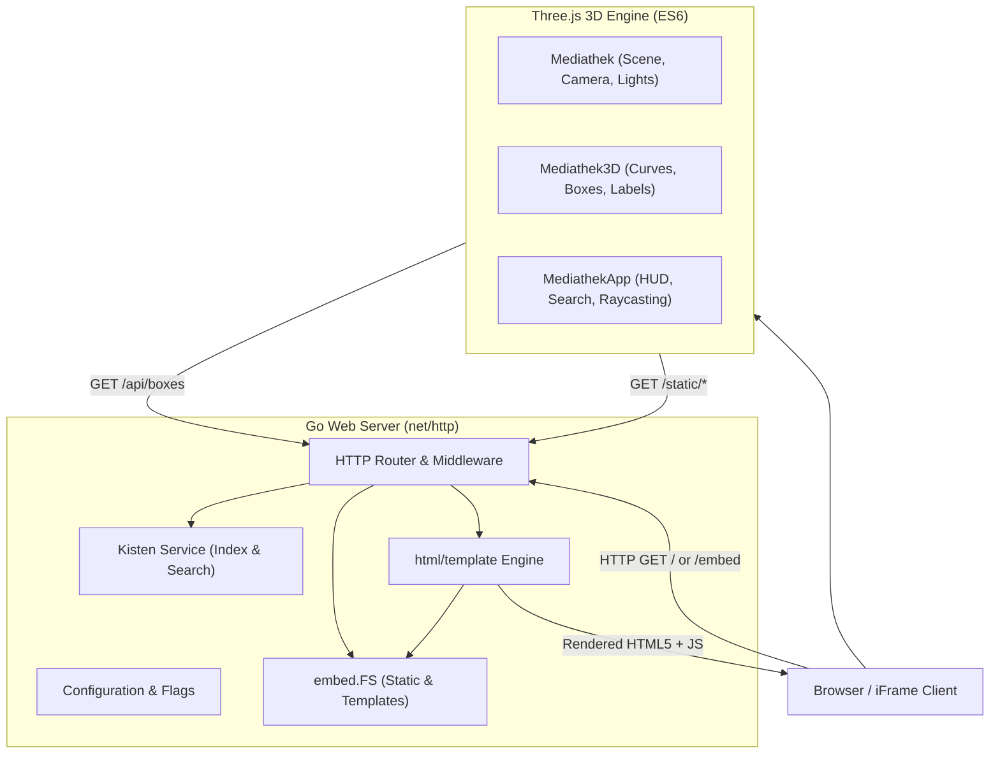

# HGK Mediathek 3D Viewer

[](https://golang.org)
[](https://threejs.org)
[](LICENSE)

A high-performance, modern 3D web application for exploring and navigating the **HGK Mediathek** library layout and open shelving system in interactive 3D WebGL.

Modernized from legacy PHP/Three.js prototype code (`3dfull.php`, `mediathek3d.js`, `mediathek.js`) into a clean, standalone Go server application powered by **Go HTML templates**, **Embedded Assets (`embed.FS`)**, **ES6 class architecture**, and **Three.js**.

---

## Features

- **Interactive 3D WebGL Scene**:
  - Accurate 3D floor map with smooth high-resolution textures.
  - Procedural generation of 21 shelving units along Catmull-Rom spline curves.
  - Dynamic 2D canvas text labeling on front face of all 514 shelving boxes.
  - Multi-level elevation and lateral indent adjustments matching real physical library shelves.
- **Modern User Interface & HUD**:
  - Glassmorphic dark theme with floating navigation controls.
  - **Live Search & Autocomplete**: Instant search by box ID (e.g. `A101`), shelf letter, or functional area with keyboard navigation (`↑`, `↓`, `Enter`, `/`).
  - **Interactive Raycasting**: Click on any shelf box in 3D to highlight, focus the camera, open the details inspection card, and update the URL permalink.
  - **Hover Tooltips**: Fast mouseover badges displaying box ID and area.
  - **Shelf Filtering**: Filter display to isolate specific shelves (e.g. Shelf A, Shelf B).
  - **Camera Controls & Presets**: Isometric Reset View (`R`), Top-down 2D Overview (`T`), and Fullscreen (`F`).
  - **CamJSON Matrix Import / Export**: Full compatibility with legacy 4x4 camera transformation matrix JSON format.
  - **High-Res Screenshot Export**: One-click PNG snapshot capture of the current 3D viewport.
- **Go Server & Templates**:
  - Delivered via Go `html/template` with server-side query parameter processing.
  - Zero external runtime dependencies: all assets (HTML, CSS, JS, textures, JSON) embedded via `embed.FS`.
  - Built-in REST API endpoints for shelf data, search, and healthchecks.
  - CORS and security headers configured for seamless iframe embedding.

---

## Quick Start

### 1. Prerequisites
- [Go 1.21+](https://golang.org/dl/)
- Any modern web browser supporting WebGL (Chrome, Firefox, Safari, Edge)

### 2. Build and Run
```bash
# Build binary
go build -o mediathek3d.exe ./cmd/mediathek3d

# Run server (default port 8080)
./mediathek3d.exe
```

Open your browser at: **[http://localhost:8080](http://localhost:8080)**

---

## URL Parameters & Deep Linking

The application supports direct deep linking via URL query parameters and location hashes:

| Parameter / Hash | Example | Description |
|---|---|---|
| `#<boxID>` | `http://localhost:8080/#A101` | Focuses and highlights box `A101` on load. Updates live during navigation. |
| `?box=<boxID>` | `http://localhost:8080/?box=A101` | Server-rendered initial box selection. |
| `?shelf=<shelves>` | `http://localhost:8080/?shelf=A,B` | Filters display to render only specific shelf units. |
| `?cam=<camJSON>` | `http://localhost:8080/?cam=[...]` | Initializes camera with a specific 16-element matrix JSON array. |
| `/embed` | `http://localhost:8080/embed?box=A101` | Clean embeddable mode without headers, optimized for iframes. |

---

## Embedding in Portals & Web Pages

To embed the 3D viewer in another website (such as library catalogs or catalog detail pages):

```html
<iframe
    src="https://your-domain.com/embed?box=A101"
    width="100%"
    height="600"
    style="border: none; border-radius: 8px;"
    allowfullscreen>
</iframe>
```

### JavaScript Events & PostMessage
The viewer emits custom DOM events for host integration:
```javascript
// Listen for box selection
window.addEventListener('mediathek:boxselected', function (event) {
    console.log("Selected Box ID:", event.detail.boxId);
    console.log("Box Data:", event.detail.data); // { shelf, level, index, area, ... }
});
```

---

## Command Line Flags & Environment Variables

| Flag | Env Variable | Default | Description |
|---|---|---|---|
| `-port` | `MEDIATHEK_PORT` | `8080` | HTTP port to listen on |
| `-host` | `MEDIATHEK_HOST` | `0.0.0.0` | Network interface host to bind |
| `-title` | `MEDIATHEK_TITLE` | `HGK Mediathek 3D` | Application title in header and browser tab |
| `-base-url` | `MEDIATHEK_BASE_URL` | `""` | Optional base URL path prefix (for reverse proxies) |
| `-data-path` | `MEDIATHEK_DATA_PATH` | `""` | Optional custom path to `kistendata.json` (defaults to embedded) |
| `-static-dir` | `MEDIATHEK_STATIC_DIR` | `""` | Live filesystem directory for frontend development |
| `-template-dir` | `MEDIATHEK_TEMPLATE_DIR` | `""` | Live filesystem directory for Go HTML template development |
| `-enable-cors` | `MEDIATHEK_ENABLE_CORS` | `true` | Enable Cross-Origin Resource Sharing |

---

## REST API Endpoints

- **`GET /api/boxes`**: Returns the complete shelf curve geometry and level configuration JSON.
- **`GET /api/boxes/search?q={query}&limit={n}`**: Searches boxes and areas by query string.
- **`GET /api/boxes/{id}`**: Returns metadata for a single box (e.g. `/api/boxes/A101`).
- **`GET /api/boxes/summary`**: Returns total counts for shelves, boxes, and area labels.
- **`GET /health`**: Healthcheck endpoint returning `{"status":"ok","version":"2.0.0"}`.

See [docs/API.md](docs/API.md) for full endpoint specifications.

---

## Architecture Overview



---

## Project Structure

```
mediathek3D/
├── cmd/
│   └── mediathek3d/
│       └── main.go               # Application entrypoint & graceful shutdown
├── pkg/
│   ├── config/                   # Server configuration & CLI flag parsing
│   ├── model/                    # Domain models for Shelves, Levels, Boxes, Points
│   ├── service/                  # Shelf & box geometry service, search, summary
│   └── web/
│       ├── embed.go              # go:embed definitions for static & templates
│       ├── handlers.go           # Web page controllers & JSON API handlers
│       ├── server.go             # HTTP server setup, routing, middlewares
│       ├── static/               # Static web assets
│       │   ├── scss/             # SCSS source & compiled mediathek3d.css
│       │   ├── data/kistendata.json
│       │   ├── img/mt_background.png
│       │   └── js/
│       │       ├── three/
│       │       │   ├── three.module.js
│       │       │   ├── three.core.js
│       │       │   └── addons/controls/
│       │       │       ├── OrbitControls.js
│       │       │       └── TrackballControls.js
│       │       ├── modules/
│       │       │   ├── math.js             # 2D/3D coordinate conversions & math utilities
│       │       │   ├── box-builder.js      # Shelf box geometry & dynamic canvas label builder
│       │       │   ├── spline-calculator.js# Catmull-Rom spline curves & box distribution math
│       │       │   └── ui-controller.js    # HUD DOM controls, search, drawer & modals
│       │       ├── mediathek-core.js   # Mediathek Three.js scene engine (ES6)
│       │       ├── mediathek-3d.js     # Mediathek3D shelf visualization coordinator (ES6)
│       │       └── mediathek-app.js    # Main application orchestrator & raycasting (ES6)
│       └── template/             # Go HTML templates
│           ├── index.gohtml      # Full-page interactive 3D viewer
│           ├── embed.gohtml      # Embeddable iframe viewer
│           └── partials/
│               ├── hud.gohtml    # Heads-Up Display controls & search bar
│               └── help_modal.gohtml # Keyboard shortcuts modal
├── docs/
│   ├── ARCHITECTURE.md           # Detailed architecture & 3D math
│   ├── API.md                    # REST API & URL parameter reference
│   └── USER_GUIDE.md             # User navigation & keyboard shortcuts guide
├── go.mod
└── README.md
```

---

## Running Tests

Execute the comprehensive unit and integration test suite:

```bash
go test -v ./...
```

---

## Documentation

- [Architecture & Technical Design (docs/ARCHITECTURE.md)](docs/ARCHITECTURE.md)
- [REST API Reference (docs/API.md)](docs/API.md)
- [User Navigation Guide (docs/USER_GUIDE.md)](docs/USER_GUIDE.md)

---

## License

Apache License 2.0. See [LICENSE](LICENSE) for details.
