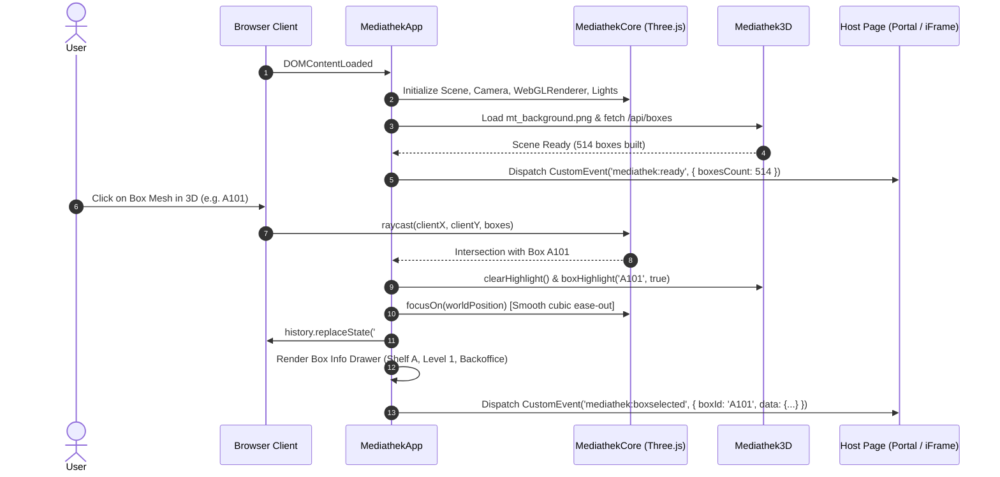

# REST API & Query Parameter Reference

This document provides specifications for all HTTP endpoints, URL query parameters, location hash routing, and JavaScript client events in **HGK Mediathek 3D**.

---

## 1. Web Page Routes

### `GET /` or `GET /index.html` or `GET /3d` or `GET /3dfull`
Renders the full-screen interactive 3D Mediathek viewer with complete HUD, search bar, box details drawer, and camera controls.

#### Supported Query Parameters:
- `box` (*string*, optional): Initial box identifier to highlight and focus upon loading (e.g. `?box=A101`).
- `shelf` (*string*, optional): Comma-separated list of shelf letters to isolate (e.g. `?shelf=A,B`).
- `cam` (*string*, optional): Camera 4x4 matrix JSON string array (e.g. `?cam=[0.99,...]`).

---

### `GET /embed`
Renders the minimal, responsive 3D viewer designed specifically for embedding inside `<iframe>` tags or library catalog modal dialogs.
Hides header branding and technical panels while maintaining full 3D navigation, box search, and click raycasting.

---

### `GET /splines` or `GET /2d` or `GET /plan`
Renders the interactive 2D floor plan visualization displaying the background image (`mt_background.png`), all control points from `kistendata.json`, and their corresponding Catmull-Rom splines.

#### Supported Features:
- Smooth Pan & Zoom (Mouse Wheel, Drag, Touch, Fit to Screen, 1:1 view).
- Live floor coordinate tracking badge (`X: 0..2048 | Y: 0..2048`).
- Layer visibility toggles (Background image with opacity slider, Splines, Points, Point labels, Shelf badges, Point coordinates).
- Shelf selection, search filter, and point coordinate inspection table.
- Interactive hover tooltips and point/spline hit-testing.

#### Supported Query Parameters:
- `shelf` (*string*, optional): Initial shelf letter to select and focus (e.g. `?shelf=A`).

---

## 2. JSON REST APIs

All JSON API endpoints return standard HTTP status codes and `Content-Type: application/json; charset=utf-8`.

---

### `GET /api/boxes`
Returns the raw shelf curve coordinates, orientation attributes, functional area labels, and level configurations.

#### Response Example:
```json
{
  "A": {
    "point": [
      { "x": 1776, "y": 1695 },
      { "x": 1773, "y": 1576 },
      { "x": 1786, "y": 1509 }
    ],
    "aside": "right",
    "area": "Backoffice",
    "level": {
      "1": { "indent": 1, "boxes": 7 },
      "2": { "indent": 1.5, "boxes": 7 },
      "3": { "indent": 2, "boxes": 7 }
    }
  }
}
```

---

### `GET /api/boxes/search`
Searches boxes by box ID prefix, shelf letter, or area name.

#### Query Parameters:
- `q` (*string*, required): Search term (e.g. `A10`, `Backoffice`, `K`). Case-insensitive.
- `limit` (*integer*, optional, default: 50): Maximum number of results to return.

#### Response Example:
```json
[
  {
    "id": "A101",
    "shelf": "A",
    "level": 1,
    "index": 1,
    "area": "Backoffice",
    "aside": "right",
    "totalInLvl": 7
  },
  {
    "id": "A102",
    "shelf": "A",
    "level": 1,
    "index": 2,
    "area": "Backoffice",
    "aside": "right",
    "totalInLvl": 7
  }
]
```

---

### `GET /api/boxes/{id}`
Returns metadata for an individual box identifier.

#### URL Parameters:
- `id` (*string*, required): 4-character box ID (e.g. `A101`, `K302`).

#### Response Example (200 OK):
```json
{
  "id": "A101",
  "shelf": "A",
  "level": 1,
  "index": 1,
  "area": "Backoffice",
  "aside": "right",
  "totalInLvl": 7
}
```

#### Response Example (404 Not Found):
```json
{
  "error": "Box \"INVALID\" not found"
}
```

---

### `GET /api/boxes/summary`
Returns aggregate statistics about the Mediathek layout.

#### Response Example:
```json
{
  "totalShelves": 21,
  "totalBoxes": 514,
  "shelfKeys": ["A", "B", "C", "D", "E", "F", "G", "H", "I", "J", "K", "L", "M", "N", "O", "P", "Q", "R", "S", "T", "U"],
  "areas": ["Backoffice", "Entrance", "General Collection", "Reading Room"]
}
```

---

### `GET /health`
Returns health status and service version for monitoring and container orchestration.

#### Response Example:
```json
{
  "status": "ok",
  "version": "2.0.0",
  "service": "mediathek3d"
}
```

---

## 3. Client JavaScript Events & Interaction Flow



### Event Specifications

### `mediathek:ready`
Fired when textures, floor plan, and 3D boxes have finished loading and initial rendering.
```javascript
window.addEventListener('mediathek:ready', function(e) {
    console.log("Mediathek 3D ready with " + e.detail.boxesCount + " boxes.");
});
```

### `mediathek:boxselected`
Fired when a user selects a box via 3D raycast click, search autocomplete, or hash change.
```javascript
window.addEventListener('mediathek:boxselected', function(e) {
    console.log("Selected box:", e.detail.boxId);
    console.log("Shelf:", e.detail.data.shelf);
    console.log("Level:", e.detail.data.level);
    console.log("Area:", e.detail.data.area);
});
```
