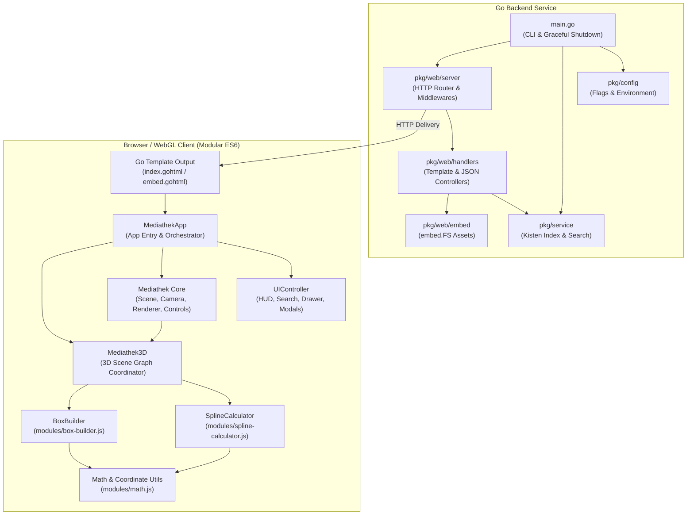
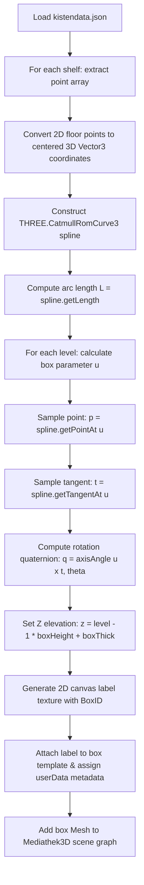

# Architectural & Technical Design

This document details the architecture, mathematical principles, and technical implementation of the **HGK Mediathek 3D Viewer**.

---

## 1. System Overview

The application is structured into two main tiers:
1. **Go Web Server**: A lightweight, standalone Go HTTP daemon serving embedded HTML templates (`html/template`), embedded static assets (`embed.FS`), and JSON REST APIs.
2. **WebGL 3D Frontend**: An ES6 class-based Three.js (r187) rendering engine utilizing native browser ES modules and HTML `<script type="importmap">`, procedural spline geometry generation, dynamic canvas text labeling, raycasting, and an interactive glassmorphic HUD.

---

## 2. 3D Mathematics & Geometry Generation

### 2.1 Coordinate Space & Floor Map
- The Mediathek floor texture (`mt_background.png`) has a resolution of **2048 × 2048 pixels**.
- To prevent sub-pixel geometry aliasing and maintain sharp visual edges, coordinates are multiplied by a `pixelFactor = 4`.
- The floor plane is centered at `(0, 0, 0)` in 3D world space:
  $$\text{worldX} = x \cdot \text{pixelFactor} - \frac{\text{floorWidth}}{2}$$
  $$\text{worldY} = y \cdot \text{pixelFactor} - \frac{\text{floorHeight}}{2}$$
  $$\text{worldZ} = 0$$

### 2.2 Catmull-Rom Spline Curve Fitting & Box Generation Pipeline

### 2.3 Box Placement & Tangent Alignment
For level $l$ with lateral indent $I$ and box index $k \in [0, N-1]$:
1. **Normalized Curve Parameter $u$**:
   $$u = \frac{(k + I) \cdot (\text{boxWidth} + \text{boxDistance}) + \frac{\text{boxWidth}}{2}}{L}, \quad u \in [0, 1]$$
2. **Position**:
   $$\mathbf{p} = \text{spline.getPointAt}(u)$$
   $$p_z = (l - 1) \cdot \text{boxHeight} + \text{boxThick}$$
3. **Tangent and Rotation Quaternion**:
   - The normalized tangent vector is obtained:
     $$\mathbf{t} = \frac{\text{spline.getTangentAt}(u)}{\|\text{spline.getTangentAt}(u)\|}$$
   - Rotation axis $\mathbf{a}$ and rotation angle $\theta$ relative to reference up vector $\mathbf{u} = (0, 1, 0)$:
     $$\mathbf{a} = \frac{\mathbf{u} \times \mathbf{t}}{\|\mathbf{u} \times \mathbf{t}\|}$$
     $$\theta = \arccos(\mathbf{u} \cdot \mathbf{t})$$
   - The box quaternion is set:
     $$\mathbf{q} = \text{Quaternion.setFromAxisAngle}(\mathbf{a}, \theta)$$

### 2.4 Dynamic Canvas Label Generation
Each box front face has a dynamically generated texture rendered on an offscreen HTML5 2D Canvas:
- Text string formatted as `    <BoxID>` (e.g. `    A101`).
- If `aside == "right"`, the 2D canvas context is rotated by $\pi$ radians ($180^\circ$) around its center to align correctly with the shelf viewing aisle.
- The canvas texture is mapped onto a transparent double-sided `THREE.MeshBasicMaterial`.

---

## 3. Frontend ES6 Class & Module Architecture

The frontend is organized into modular, single-responsibility ES6 modules under `pkg/web/static/js/`:

### 3.1 `Math & Utilities` (`pkg/web/static/js/modules/math.js`)
- `calcX(x, pixelFactor, floorSize)`, `calcY(y, pixelFactor, floorSize)`: Pure 2D floor pixel to centered 3D world coordinate mappings.
- `nearestPow2(size)`: Calculates nearest power-of-two dimensions for WebGL texture allocations.
- `clamp(value, min, max)`: Boundary constraint helper.

### 3.2 `BoxBuilder` (`pkg/web/static/js/modules/box-builder.js`)
- Manages reusable open-box template geometries (`bottom`, `top`, `left`, `right` walls) and bottom plate placeholders.
- `createLabelTexture(text, aside, textColor)`: Renders 2D offscreen canvas textures with auto-rotated text labels for right-sided aisles.
- `createBox(fullname, shelfData)`, `createBottom(fullname, shelfData)`: Instantiates individual 3D box meshes with `userData` metadata.

### 3.3 `SplineCalculator` (`pkg/web/static/js/modules/spline-calculator.js`)
- `createCurveFromPoints(points2D)`: Constructs 3D `THREE.CatmullRomCurve3` splines from 2D shelf floor control points.
- `calculateBoxTransform(spline, boxIndex, indent, levelNum)`: Computes normalized parameter $u \in [0, 1]$, curve 3D position vector, curve tangent, rotation quaternion, and Z-elevation per shelf level.

### 3.4 `UIController` (`pkg/web/static/js/modules/ui-controller.js`)
- Caches and manages all HUD and modal DOM elements.
- Handles search input, keyboard navigation, and autocomplete suggestion dropdowns.
- Manages box information inspection drawer, floating hover tooltips, camera JSON panel, fullscreen toggle, and help modal.

### 3.5 `Mediathek` (`pkg/web/static/js/mediathek-core.js`)
- Manages the WebGLRenderer, Scene graph, Ambient/Directional lights, and OrbitControls.
- **High-DPI Support**: Automatically scales `renderer.setPixelRatio(Math.min(window.devicePixelRatio, 2))`.
- **Camera JSON Serialization**:
  - `getCamJSON()`: Extracts the 16 float elements of `camera.matrixWorld`.
  - `setCamJSON(json)`: Decomposes the 4x4 matrix into position, quaternion rotation, and scale vectors, updating the camera pose and orbit control target.
- **Smooth View Transitions**:
  - `animateCameraTo(cameraPos, targetPos, duration)`: Cubic ease-out interpolation of camera and orbit target.
- **Raycasting**: Normalized device coordinates raycaster for mouse/touch picking.
- **Screenshot Export**: `downloadScreenshot(filename, width, height)` exports high-resolution PNG images.

### 3.6 `Mediathek3D` (`pkg/web/static/js/mediathek-3d.js`)
- Extends `THREE.Object3D`.
- Asynchronously loads textures and shelf JSON data via Promises / Fetch API.
- Coordinates `SplineCalculator` and `BoxBuilder` to generate floor planes, satellite textures, spline curves, and all shelf boxes.
- Provides `boxHighlight(boxId, highlight, customColor)`, `clearHighlights()`, and `selectBox(boxId)`.
- Provides `searchBoxes(query)` and `getBoxMetadata(boxId)`.

### 3.7 `MediathekApp` (`pkg/web/static/js/mediathek-app.js`)
- Main application orchestrator uniting `Mediathek`, `Mediathek3D`, and `UIController`.
- Binds viewport mouse pointer events (`pointermove` for hover tooltip, `click` for selection).
- Manages camera view presets (Isometric Reset, Top-Down View), URL parameter parsing, and CamJSON synchronization.

---

## 4. Go Backend Architecture

### 4.1 Asset Embedding (`pkg/web/embed.go`)
Using Go's standard library `embed` package:
- `//go:embed static/*`: Binds all static CSS, JS, textures, and data directly into the binary.
- `//go:embed template/*`: Binds all HTML templates into the binary.
- Result: **Single-binary zero-dependency distribution**.

### 4.2 Kisten Service (`pkg/service/kisten.go`)
- Thread-safe repository and indexing service for shelves and boxes.
- Parses shelf point arrays, orientation attributes (`aside`), functional areas, and multi-level capacities.
- Pre-indexes all 514 boxes for $O(1)$ ID lookups and fast substring searching.

### 4.3 HTTP Server & Middlewares (`pkg/web/server.go`)
- **CORS Middleware**: Allows cross-origin embedding and REST API calls.
- **Security Headers Middleware**: Sets `X-Content-Type-Options: nosniff` and allows iframe embedding (`X-Frame-Options: ALLOWALL`).
- **Panic Recovery Middleware**: Catches unhandled panics and logs structured error traces.
- **Logging Middleware**: Measures and reports HTTP method, path, status code, and latency.

---

## 5. SCSS & File Watcher Pipeline

The styling pipeline is organized under `pkg/web/static/scss/`:
- `mediathek3d.scss`: Master SCSS bundle importing modular partials using `@use`.
- `_variables.scss`, `_base.scss`, `_hud.scss`, `_search.scss`, `_drawer.scss`, `_cam-panel.scss`, `_modals.scss`, `_components.scss`, `_embed.scss`.
- Generated CSS: `pkg/web/static/scss/mediathek3d.css` (and sourcemap) reside directly in the same directory.
- IDE Integration: `.idea/watcherTasks.xml` configures JetBrains File Watchers to invoke `$ProjectFileDir$/node_modules/.bin/sass.cmd` automatically upon saving any `.scss` file.
